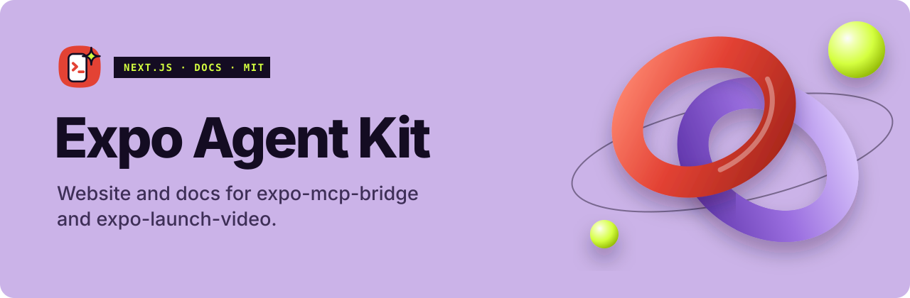

<p align="center">
  <a href="https://rudrasamadhiya.github.io/expo-agent-kit/">
    <picture>
      <source media="(prefers-color-scheme: dark)" srcset=".github/assets/banner-dark.svg">
      
    </picture>
  </a>
</p>

<p align="center">
  <a href="https://github.com/Rudrasamadhiya/expo-agent-kit/actions/workflows/deploy.yml"></a>
  <a href="https://www.npmjs.com/package/expo-mcp-bridge"></a>
  <a href="https://www.npmjs.com/package/expo-launch-video"></a>
  <a href="LICENSE"></a>
</p>

<p align="center">
  <a href="https://rudrasamadhiya.github.io/expo-agent-kit/"><b>Live site</b></a> ·
  <a href="https://github.com/Rudrasamadhiya/expo-mcp-bridge"><b>expo-mcp-bridge</b></a> ·
  <a href="https://github.com/Rudrasamadhiya/expo-launch-video"><b>expo-launch-video</b></a>
</p>

---

The website and documentation for two open-source MCP libraries for Expo and React Native:

| Package | What it does |
| --- | --- |
| [`expo-mcp-bridge`](https://github.com/Rudrasamadhiya/expo-mcp-bridge) | Lets AI agents (Claude Code, Antigravity, Cursor, any MCP client) see, tap, type, scroll, screenshot and debug your Expo app on a real phone. |
| [`expo-launch-video`](https://github.com/Rudrasamadhiya/expo-launch-video) | Lets the agent shoot your app live and cut a polished launch video — motion graphics, pop-outs, sound — in a promptable studio, exported as MP4. |

## What's inside

- **Landing page** with a live agent ⇄ phone demo, launch-video storyboard, studio tour and how-it-works diagram.
- **Docs** for both libraries: installation, connecting your agent, every MCP tool with its parameters, the `<AgentBridge />` API, CLI and environment variables, the studio, and troubleshooting.
- **One-shot AI setup** page — paste one line into your agent and it installs everything.
- Two themes — Midnight (jet black, hot pink, chartreuse) and Ivory (ivory, emerald, vermilion) — keyboard-accessible, respects reduced motion, works at phone width.

Built with Next.js (static export), React, Tailwind CSS, Motion, Shiki and two [React Bits](https://reactbits.dev) components, set in Mona Sans. No analytics, no cookies.

## Develop

Requires Node.js 20.9 or newer.

```bash
npm install
npm run dev
```

Open http://localhost:3000.

## Test

```bash
npm run lint        # ESLint
npm run typecheck   # TypeScript
npm test            # Vitest component and content tests
npm run build       # static export to out/
npm run test:links  # every internal link, asset and #anchor in out/
```

To check the build exactly as GitHub Pages serves it (under `/expo-agent-kit`):

```bash
BASE_PATH=/expo-agent-kit npm run build
BASE_PATH=/expo-agent-kit npm run test:links
```

## Project layout

```
src/app/            pages (landing + /docs/…)
src/components/     UI: header, code blocks, tabs, demo animations, docs sidebar
src/content/        site config, docs navigation, tool reference data
scripts/            post-build fix for static prefetch files, link checker
test/               Vitest tests
```

Tool names, parameters, CLI flags and versions live in `src/content/` — update them there when a library changes.

## Deploy

Pushing to `main` runs `.github/workflows/deploy.yml`: lint, typecheck, tests, build with `BASE_PATH=/expo-agent-kit`, link check, then publish `out/` to GitHub Pages.

## License

[MIT](LICENSE) © 2026 Rudra Samadhiya. Third-party credits are listed on the site's [License & credits](https://rudrasamadhiya.github.io/expo-agent-kit/docs/license/) page.
